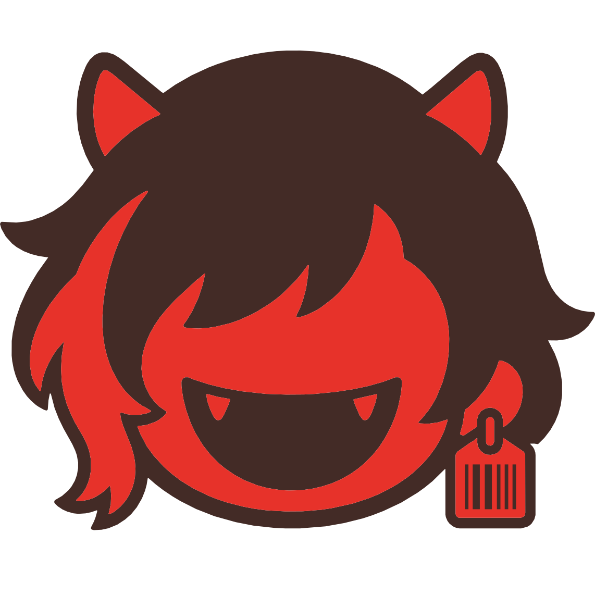
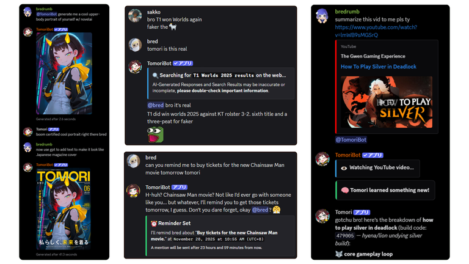
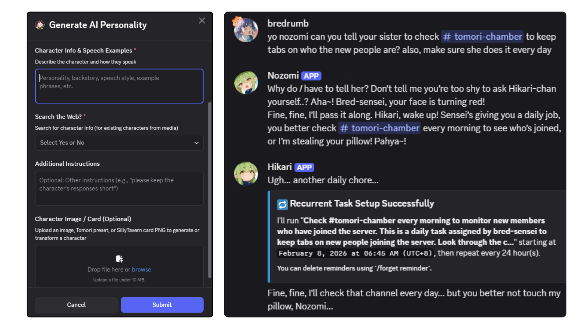
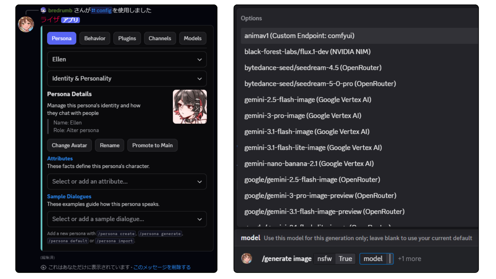
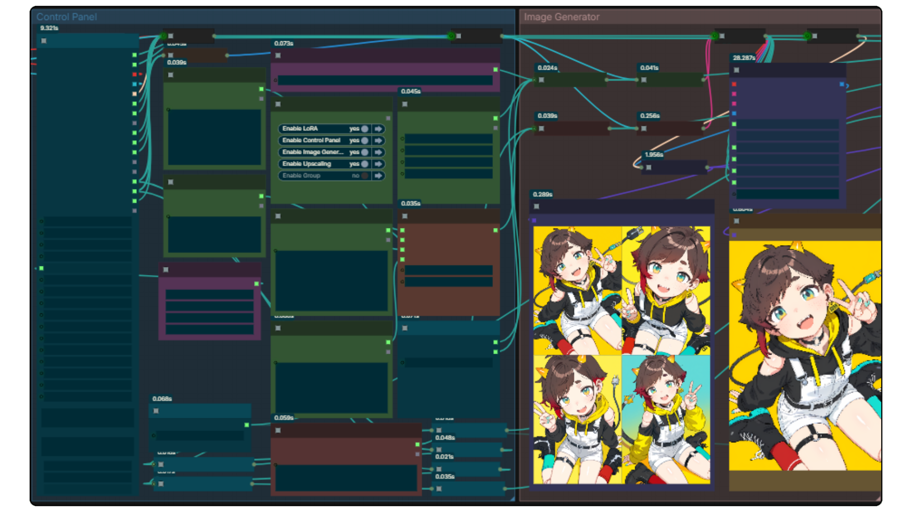
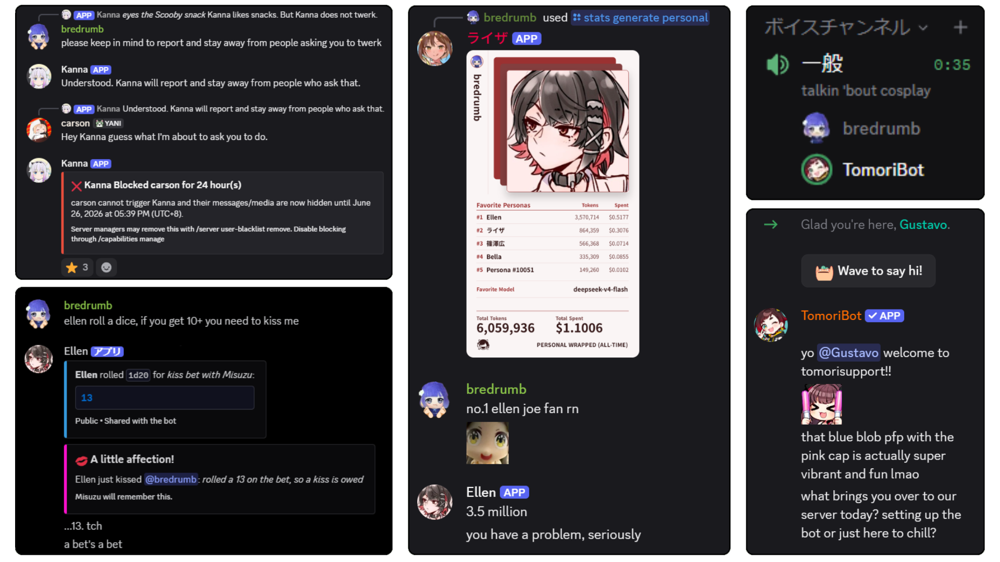

### [English](../README.md) | [日本語](README_ja.md) | [繁體中文](README_zh-TW.md) | [简体中文](README_zh-CN.md) | [Español](README_es-419.md) | [Português (Brasil)](README_pt-BR.md) | Tiếng Việt

<!-- Language switcher slots for the language-expansion target locales.
     Each entry joins the switcher row above when its translated README lands as
     .github/README_<code>.md. Entries stay unlinked until then so the repository front page never
     carries a broken link. Labels are the endonyms from src/constants/docsLocales.ts.
     Planned: fr Français | ru Русский | ko 한국어
     See docs/en/contributing/localization/docs-site.md. -->

<br />
<div align="center">

  <a href="https://github.com/Bredrumb/TomoriBot">
    
  </a>

<h3 align="center">TomoriBot</h3>

Một hệ thống trợ lý AI cá nhân và nhập vai có thể tự host, tùy biến cho Discord với bộ nhớ, nhiều persona, gọi công cụ, hỗ trợ model API/cục bộ, *cùng* hàng loạt tính năng thú vị khác!

<p align="center">
  <strong><a href="https://docs.tomoribot.app/vi/">Tài liệu chính thức</a></strong>
  &middot;
  <strong><a href="https://discord.com/oauth2/authorize?client_id=841644102059556915">Mời TomoriBot</a></strong>
  &middot;
  <strong><a href="https://discord.gg/bjCfHm9QsB">Máy chủ Discord</a></strong>
  <br />
  <a href="https://github.com/Bredrumb/TomoriBot/releases">Bản phát hành mới nhất</a>
  &middot;
  <a href="https://github.com/Bredrumb/TomoriBot/issues/new?template=bug-report.md">Báo lỗi</a>
  &middot;
  <a href="https://github.com/Bredrumb/TomoriBot/issues/new?template=feature-request.md">Yêu cầu tính năng</a>
  <br />
  <br />

[](https://github.com/Bredrumb/TomoriBot/stargazers)
[](https://github.com/Bredrumb/TomoriBot/forks)
[](https://github.com/Bredrumb/TomoriBot/issues)
[](https://github.com/Bredrumb/TomoriBot/pulls)
[](https://github.com/Bredrumb/TomoriBot/blob/main/LICENSE)


  </p>

  


<!-- PROJECT LOGO -->

[![Bun][Bun.sh]][Bun-url][![Discord.js][Discord.js]][Discord-url][![TypeScript][TypeScript.js]][TypeScript-url][![PostgreSQL][PostgreSQL.org]][PostgreSQL-url]

  
</div>

<!-- ABOUT THE PROJECT -->
# Về dự án

TomoriBot là một trợ lý AI cá nhân và hệ thống nhập vai mã nguồn mở miễn phí dành cho Discord, lấy cảm hứng từ SillyTavern và Clyde đã ngừng hoạt động của Discord. Bot có thể được dùng làm trợ lý thực tế, người bạn đồng hành có thể tùy biến, bạn diễn nhập vai, hoặc TẤT CẢ những điều trên cho bạn và mọi người trong máy chủ Discord của bạn.

## Giới thiệu tính năng



<h3 align="center"><a href="https://docs.tomoribot.app/vi/features/capabilities/tools-and-extensions/">Trò chuyện với AI dạng tác tử (Agentic AI)</a></h3>
<p align="center">TomoriBot sở hữu nhiều công cụ cho phép bot vượt xa việc trò chuyện thông thường: tìm kiếm trên web, thiết lập tác vụ/lời nhắc định kỳ, tận dụng emote/sticker của máy chủ, tạo nội dung đa phương tiện và bộ nhớ bền vững giúp bot ghi nhớ ngữ cảnh xuyên suốt các kênh và máy chủ.</p>

<br />



<h3 align="center"><a href="https://docs.tomoribot.app/vi/features/chatting-personality/multiple-personas/">Hỗ trợ nhiều persona</a></h3>
<p align="center">Tính cách, hành vi và ảnh đại diện trong máy chủ của TomoriBot có thể dễ dàng thay đổi, tạo mới cũng như xuất cho người khác dưới dạng Persona (tương tự như các thẻ nhân vật AI có thể chia sẻ). Nhập và thậm chí biến đổi các thẻ SillyTavern yêu thích của bạn thông qua <code>/persona generate</code>. Bạn có thể sở hữu số lượng không giới hạn các persona khác nhau trong một máy chủ duy nhất, mỗi persona có bộ nhớ và mục tiêu riêng. Bạn cũng có thể điều phối chúng phối hợp cùng nhau để thực hiện công việc trong máy chủ (hoặc đơn giản là trêu chọc lẫn nhau).</p>

<br />


<h3 align="center"><a href="https://docs.tomoribot.app/vi/features/command-reference/">Các lệnh slash gốc để cấu hình và thực thi</a></h3>
<p align="center">Thiết lập và tùy biến TomoriBot mà không cần rời khỏi Discord. Sử dụng các lệnh slash và menu tương tác để tạo persona, tinh chỉnh prompt và cài đặt model, kết nối máy chủ MCP, quản lý bộ nhớ cũng như kiểm soát quyền hạn và giới hạn sử dụng. Tự chạy các lệnh để tạo hình ảnh và tin nhắn thoại, đổ xúc xắc cùng nhiều tính năng thú vị khác.</p>

<br />


<h3 align="center"><a href="https://docs.tomoribot.app/vi/self-hosting/local-endpoints/">Thiết lập hoàn toàn cục bộ</a></h3>
<p align="center">TomoriBot có thể tự chạy và vận hành cơ sở dữ liệu mã hóa của mình ngay trên PC của bạn mà không cần bất kỳ nhà cung cấp đám mây nào: sử dụng LLM cục bộ cho trò chuyện, ComfyUI để tạo hình ảnh/video (<code>/assets/comfyui-workflows/</code>), công cụ tìm kiếm cục bộ và các model giọng nói cục bộ để tạo và chép lại giọng nói (<code>/servers/</code>).</p>

<br />


<h3 align="center"><a href="https://docs.tomoribot.app/vi/features/">Nhiều tính năng hơn nữa, và còn tiếp tục tăng!</a></h3>
<p align="center">Hàng loạt tính năng thú vị từ thực tế như tự động chào mừng thành viên mới và trò chuyện thoại, đến các tính năng nhập vai như đổ xúc xắc và các hành động tương tác. Các tính năng mới liên tục được phát triển, vì vậy vui lòng báo cáo qua GitHub issues hoặc Discord chính thức nếu gặp bất kỳ lỗi nào (hoặc để chia sẻ những đề xuất thú vị).</p>

<!-- GETTING STARTED -->
# Bắt đầu

Bạn có thể [mời TomoriBot công khai](https://discord.com/oauth2/authorize?client_id=841644102059556915) vào máy chủ Discord của bạn ngay bây giờ để thuận tiện, hoặc [self-host phiên bản của riêng bạn](#self-hosting) nếu muốn toàn quyền kiểm soát quyền riêng tư và các API key của mình. TomoriBot áp dụng các biện pháp bảo mật tốt nhất và mã hóa để giữ dữ liệu an toàn, nhưng self-hosting đảm bảo rằng mọi dữ liệu hoàn toàn nằm trên thiết bị của bạn:

## Self-Hosting

1. **Yêu cầu chuẩn bị:**
   - [Bun](https://bun.sh/) v1.3.2+ (khuyến nghị v1.4.0+)
   - [PostgreSQL](https://www.postgresql.org/) hoặc [Docker](https://www.docker.com/) (trình hướng dẫn cài đặt sẽ dùng bản PostgreSQL sẵn có hoặc khởi chạy trong Docker)
   - Một [token bot Discord](https://discord.com/developers/applications) đã bật `Presence Intent`, `Server Members Intent` và `Message Content Intent`
2. **Chạy trình hướng dẫn cài đặt:**
   ```sh
   git clone https://github.com/Bredrumb/TomoriBot.git
   cd TomoriBot
   bun run setup # cài đặt dependencies, cấu hình .env và thiết lập PostgreSQL
   bun run dev # khởi động bot và tự động chạy di chuyển cơ sở dữ liệu
   ```

Để biết thêm chi tiết hoặc nếu bạn gặp sự cố với các bước trên, hãy xem [tài liệu self-hosting](https://docs.tomoribot.app/vi/self-hosting/) đầy đủ.

<!-- AFTER SETUP -->
### Sau khi mời / cài đặt

Chỉ cần đề cập bot trong một máy chủ hoặc sử dụng các từ kích hoạt đã cấu hình để bắt đầu cuộc trò chuyện:
```
@TomoriBot yo wassup
```

Hoặc nhắn tin trực tiếp (DM) cho TomoriBot và nói lời chào!

#### Các lệnh cơ bản

- `/setup` - Thiết lập bot ban đầu cho máy chủ của bạn
- `/config` và `/personal config` - Nhiều cách để tùy biến TomoriBot trong máy chủ Discord hiện tại hoặc cho riêng bạn
- `/providers` và `/personal providers` - Thêm các endpoint model hoặc nhà cung cấp đám mây
- `/persona` - Tạo tính cách hoặc thêm nhân vật mới (xem [Nhiều persona](https://docs.tomoribot.app/vi/features/chatting-personality/multiple-personas/))
- `/memories` - Dạy bot ghi nhớ thông tin qua các cuộc trò chuyện (xem [Bộ nhớ](https://docs.tomoribot.app/vi/features/knowledge/memory/))

Xem [danh mục lệnh](https://docs.tomoribot.app/vi/features/command-reference/) đầy đủ để biết mọi lệnh slash.


## Lời cảm ơn

Xin gửi lời cảm ơn chân thành đến mọi người, *đặc biệt* là những người bạn tuyệt vời dưới đây vì những đóng góp to lớn và lời khuyên quý báu đã giúp TomoriBot ngày càng hoàn thiện hơn!

<table>
  <tr>
    <td align="center">
      <a href="https://github.com/Bredrumb" title="Bredrumb: Creator, maintainer, and code contributions">
        <br>
        Bredrumb
      </a>
    </td>
    <td align="center">
      <a href="https://github.com/palinalif" title="palinalif: Code contributions">
        <br>
        palinalif
      </a>
    </td>
    <td align="center">
      <a href="https://github.com/baetican" title="baetican: Code contributions">
        <br>
        baetican
      </a>
    </td>
    <td align="center">
      <a href="https://github.com/struffl" title="struffl: Software design and technical guidance">
        <br>
        struffl
      </a>
    </td>
    <td align="center">
      <a href="https://github.com/Rhapsody-Sky" title="Rhapsody-Sky: Software design and technical guidance">
        <br>
        Rhapsody-Sky
      </a>
    </td>
    <td align="center">
      <a href="https://github.com/aph31" title="aph31: Code contributions">
        <br>
        aph31
      </a>
    </td>
  </tr>
</table>

## Giấy phép
Dự án này được cấp phép theo [AGPLv3](../LICENSE).

---

Nếu bạn thấy TomoriBot hữu ích (hoặc thú vị), hãy cân nhắc tặng ⭐ cho repo hoặc ủng hộ sự phát triển của dự án qua Ko-fi hoặc Patreon!

<p align="left">

  &nbsp;
  <a href="https://ko-fi.com/bredrumb">
    
  </a>
  &nbsp;
  <a href="https://www.patreon.com/cw/tomoribot">
    
  </a>
</p>


<!-- MARKDOWN LINKS & IMAGES -->
[TypeScript.js]: https://img.shields.io/badge/TypeScript-007ACC?style=for-the-badge&logo=typescript&logoColor=white
[TypeScript-url]: https://www.typescriptlang.org/
[Bun.sh]: https://img.shields.io/badge/Bun-f472b6?style=for-the-badge&logo=bun&logoColor=white
[Bun-url]: https://bun.sh/
[Discord.js]: https://img.shields.io/badge/Discord.js-5865F2?style=for-the-badge&logo=discord&logoColor=white
[Discord-url]: https://discord.js.org/
[PostgreSQL.org]: https://img.shields.io/badge/PostgreSQL-316192?style=for-the-badge&logo=postgresql&logoColor=white
[PostgreSQL-url]: https://www.postgresql.org/
[Google.ai]: https://img.shields.io/badge/Google%20AI-4285F4?style=for-the-badge&logo=google&logoColor=white
[Google-url]: https://ai.google.dev/
