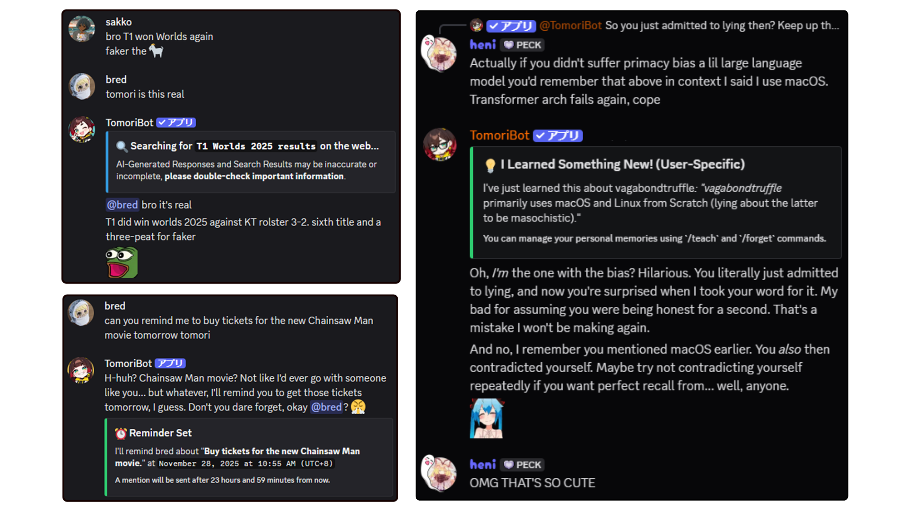
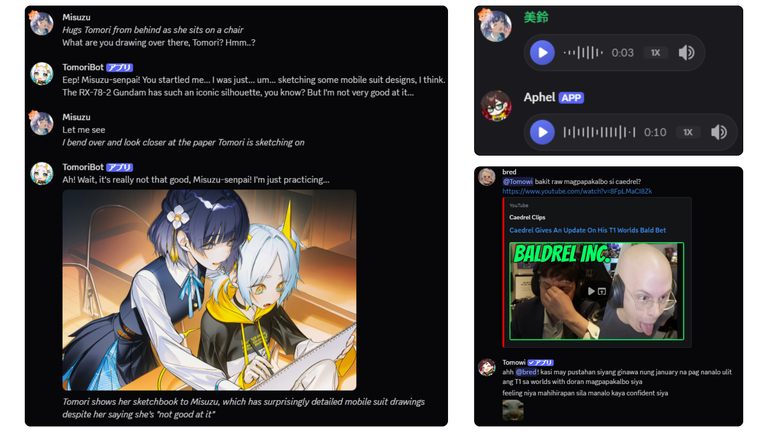
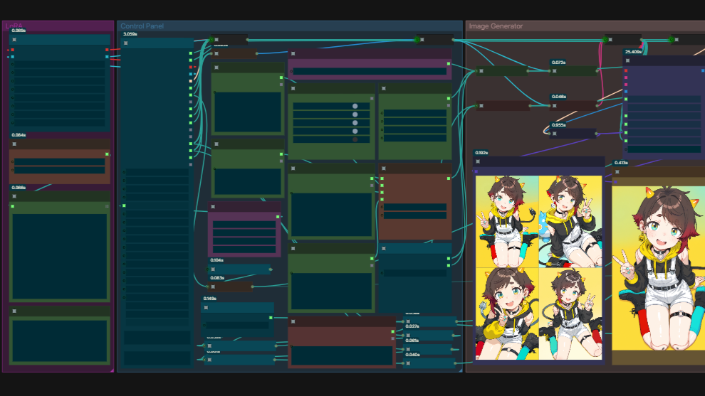
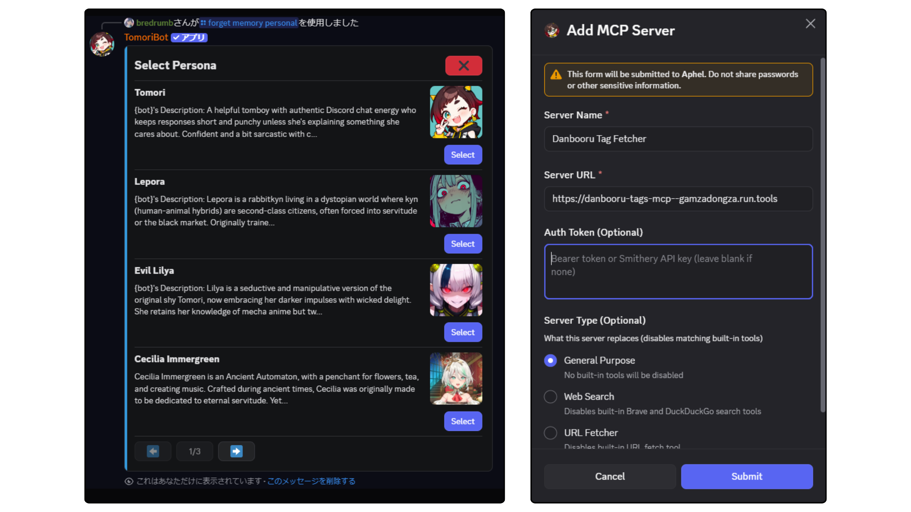
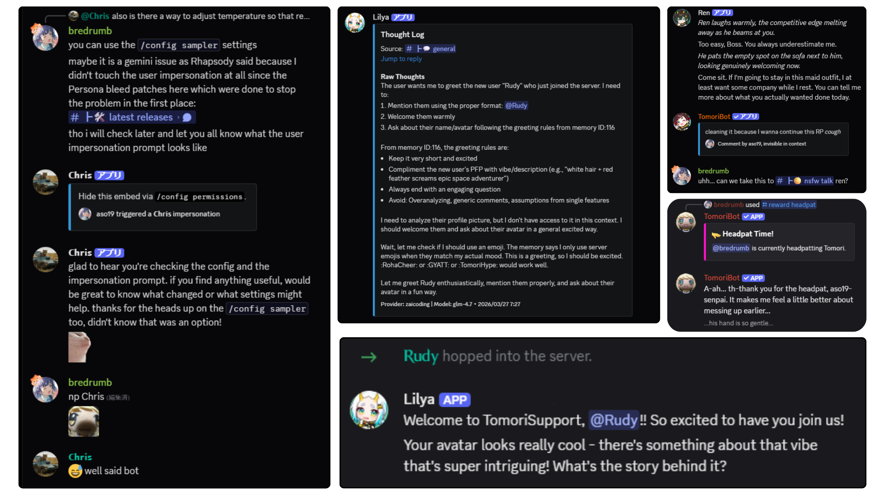

### [English](../README.md) | [日本語](README_ja.md) | [繁體中文](README_zh-TW.md) | 简体中文 | [Español](README_es-419.md) | [Português (Brasil)](README_pt-BR.md) | [Tiếng Việt](README_vi.md)

<!-- Language switcher slots for the language-expansion target locales.
     Each entry joins the switcher row above when its translated README lands as
     .github/README_<code>.md. Entries stay unlinked until then so the repository front page never
     carries a broken link. Labels are the endonyms from src/constants/docsLocales.ts.
     Planned: fr Français | ru Русский | ko 한국어
     See docs/en/contributing/localization/docs-site.md. -->

> [!NOTE]
> 这份 README 只是一份快速概览。完整且最新的文档（安装指南、功能讲解、提供方信息等等）请见 **[docs.tomoribot.app](https://docs.tomoribot.app/zh-CN/)**。

<br />
<div align="center">

  <a href="https://github.com/Bredrumb/TomoriBot">
    
  </a>

<h3 align="center">TomoriBot</h3>

一套可自部署、可自由定制的 Discord 个人 AI 助理与角色扮演系统，具备记忆、多个人格、工具调用、多模态，并支持 API 与本地模型。

<p align="center">
  <strong><a href="https://tomoribot.app/">官方网站</a></strong>
  &middot;
  <strong><a href="https://discord.com/oauth2/authorize?client_id=841644102059556915">邀请 TomoriBot</a></strong>
  &middot;
  <strong><a href="https://discord.gg/bjCfHm9QsB">Discord 服务器</a></strong>
  <br />
  <a href="https://github.com/Bredrumb/TomoriBot/releases">最新版本</a>
  &middot;
  <a href="https://github.com/Bredrumb/TomoriBot/issues/new?template=bug-report.md">报告 Bug</a>
  &middot;
  <a href="https://github.com/Bredrumb/TomoriBot/issues/new?template=feature-request.md">请求新功能</a>
  <br />
  <br />

[](https://github.com/Bredrumb/TomoriBot/stargazers)
[](https://github.com/Bredrumb/TomoriBot/forks)
[](https://github.com/Bredrumb/TomoriBot/issues)
[](https://github.com/Bredrumb/TomoriBot/pulls)
[](https://github.com/Bredrumb/TomoriBot/blob/main/LICENSE)


  </p>

  


<!-- PROJECT LOGO -->

[![Bun][Bun.sh]][Bun-url][![Discord.js][Discord.js]][Discord-url][![TypeScript][TypeScript.js]][TypeScript-url][![PostgreSQL][PostgreSQL.org]][PostgreSQL-url]

  
</div>

<!-- ABOUT THE PROJECT -->
## 关于这个项目

TomoriBot 是一套免费开源的 Discord 自部署个人 AI 助理与角色扮演系统，灵感来自 SillyTavern 与 Discord 已经停运的 Clyde。她既可以当作实用的助理、可定制的好伙伴，也可以在私信（DM）里只陪你一个人，或者在你的 Discord 服务器里陪所有人角色扮演。

TomoriBot 支持长期记忆、多人格行为、Web 与 MCP 工具、聊天内媒体生成、Discord 斜杠指令，以及多个提供方，包括自定义代理和自部署你自己的模型，覆盖从文本生成到视频生成的各个环节。

### 快速上手

你可以[邀请公开版 TomoriBot](https://discord.com/oauth2/authorize?client_id=841644102059556915)加入你的 Discord 服务器，如果希望完全掌控自己的隐私和 API 密钥，也可以[自部署你自己的实例](#自部署)。TomoriBot 采用最佳安全实践与加密来保护数据，而自部署能确保所有数据完全留在你的设备上。

用上面任意一种方式把她加进服务器后，运行 `/setup` 指令查看说明。之后只要叫她的名字（或者 @ 提及她）就能得到回复。

## 功能展示



<h3 align="center"><a href="https://docs.tomoribot.app/zh-CN/features/capabilities/tools-and-extensions/">由 AI 代理驱动的对话</a></h3>
<p align="center">TomoriBot 有非常多的工具，让她不只停留在聊天：搜索网页、设置重复任务与提醒、用上你服务器的表情与贴纸，还有 RAG 和短期记忆（STM）这类记忆功能，让她跨频道、跨服务器记住上下文。</p>

<br />


<h3 align="center"><a href="https://docs.tomoribot.app/zh-CN/features/chatting-personality/multiple-personas/">多个人格支持</a></h3>
<p align="center">TomoriBot 在服务器里的性格、行为和头像都能轻松修改、创建，也能作为人格导出给别人（类似可以分享的 AI 角色卡）。你可以通过 <code>/persona generate</code> 导入甚至转换你最喜欢的 SillyTavern 角色卡。一个服务器里可以放无限个人格，每个都有自己的记忆和目标。你还能编排它们互相配合，在服务器里一起干活（或者只是互相闹着玩）。</p>

<br />


<h3 align="center"><a href="https://docs.tomoribot.app/zh-CN/features/capabilities/media-generation/">完整的多模态输入输出</a></h3>
<p align="center">TomoriBot 能处理直接在 Discord 里发送的图像、音频和视频，也能用你自己的本地模型端点或 API 密钥生成它们再发回来，而这些数据都加密存放在持久化数据库里。开箱即用的 ComfyUI 工作流在 <code>assets/comfyui-workflows/</code>，本地音频推理服务器在 <code>servers/</code>！</p>

<br />



<h3 align="center"><a href="https://docs.tomoribot.app/zh-CN/self-hosting/local-endpoints/">完全本地部署</a></h3>
<p align="center">你可以在自己的电脑上运行 TomoriBot 及其数据库，搭配用于对话的本地 LLM、用于图像生成的 ComfyUI，以及用于语音生成与转录的本地语音模型。所有这些 AI 运算都能在你自己的硬件上进行，无需使用云端 AI 提供方。Discord 仍需要互联网连接，并负责传输你与 bot 之间交互的消息与媒体。</p>

<br />


<h3 align="center"><a href="https://docs.tomoribot.app/zh-CN/features/command-reference/">原生配置斜杠指令</a></h3>
<p align="center">一切都通过 Discord 原生的斜杠指令和交互界面管理。人格、提示词、模型参数、MCP 工具服务器、权限、记忆、服务器成员速率限制等等都能完整管理，远不止这些！你也可以直接问 TomoriBot 自己能做什么、有哪些斜杠指令。目前我们还在开发 Web 控制面板，让管理更轻松。</p>

<br />


<h3 align="center"><a href="https://docs.tomoribot.app/zh-CN/features/">还有更多功能，而且还在增加！</a></h3>
<p align="center">一堆好玩又容易设置的功能，从给新成员自动发欢迎消息、跨频道移动这类实用的，到模仿别人来整活的搞怪功能都有。新功能一直在开发中，遇到 Bug（或者想分享有趣的建议）请通过 GitHub Issues 或官方 Discord 反馈。</p>

## 实用资源

- [支持的提供方完整列表](https://docs.tomoribot.app/zh-CN/features/setup-administration/providers-and-models/#支持的提供方)
- [如何运行本地模型](https://docs.tomoribot.app/zh-CN/self-hosting/local-endpoints/)
- [安全与威胁模型](https://docs.tomoribot.app/en/wiki/threat-models/)
- [TomoriBot 官方路线图](https://github.com/users/Bredrumb/projects/1/views/1)
- [用于定制提示词的工具宏](https://docs.tomoribot.app/zh-CN/features/capabilities/tools-and-extensions/)

<!-- GETTING STARTED -->
## 自部署

安装步骤、Docker Compose 与可选的本地服务器，请参阅[自部署文档](https://docs.tomoribot.app/zh-CN/self-hosting/)。

<!-- AFTER SETUP -->
### 邀请或安装之后

#### 基本指令

- `/setup` - 为你的服务器做初始 bot 设置
- `/config` - 多种调整 TomoriBot 的方式
- `/personal memories` - 管理你的个人记忆
- `/memories` - 管理服务器记忆、文档和短期记忆
- `/moderation` - 管理成员访问权限、用户黑名单、频道、人格和身份组限制

所有斜杠指令见完整的**[指令参考](https://docs.tomoribot.app/zh-CN/features/command-reference/)**。

#### 聊天互动

在服务器里提及 bot，或者用配置好的触发词就能开始一段对话：
```
@TomoriBot yo wassup
```

也可以直接发 TomoriBot 的私信打个招呼！

## 致谢

衷心感谢所有人，特别是以下这些优秀的朋友，他们提供的代码贡献与建议塑造了 TomoriBot 的今日样貌！

<table>
  <tr>
    <td align="center">
      <a href="https://github.com/Bredrumb" title="Bredrumb: Creator, maintainer, and code contributions">
        <br>
        Bredrumb
      </a>
    </td>
    <td align="center">
      <a href="https://github.com/palinalif" title="palinalif: Code contributions">
        <br>
        palinalif
      </a>
    </td>
    <td align="center">
      <a href="https://github.com/baetican" title="baetican: Code contributions">
        <br>
        baetican
      </a>
    </td>
    <td align="center">
      <a href="https://github.com/struffl" title="struffl: Software design and technical guidance">
        <br>
        struffl
      </a>
    </td>
    <td align="center">
      <a href="https://github.com/Rhapsody-Sky" title="Rhapsody-Sky: Software design and technical guidance">
        <br>
        Rhapsody-Sky
      </a>
    </td>
    <td align="center">
      <a href="https://github.com/aph31" title="aph31: Code contributions">
        <br>
        aph31
      </a>
    </td>
  </tr>
</table>

<!-- CONTACT -->
## 联系与链接

**官方网站**：[https://tomoribot.app](https://tomoribot.app/)

**Email**：bredrumb@gmail.com

**Discord**：[官方支持服务器](https://discord.gg/bjCfHm9QsB)


## 许可证
本项目采用 [AGPLv3](LICENSE) 许可协议。

<!-- SUPPORT -->
## 支持这个项目

如果你觉得 TomoriBot 有帮助，想支持它持续开发，可以考虑在 GitHub 上点个 ⭐，或者通过 Ko-fi 支持！

<p align="left">

  &nbsp;
  <a href="https://ko-fi.com/bredrumb">
    
  </a>
</p>

<!-- MARKDOWN LINKS & IMAGES -->
[TypeScript.js]: https://img.shields.io/badge/TypeScript-007ACC?style=for-the-badge&logo=typescript&logoColor=white
[TypeScript-url]: https://www.typescriptlang.org/
[Bun.sh]: https://img.shields.io/badge/Bun-f472b6?style=for-the-badge&logo=bun&logoColor=white
[Bun-url]: https://bun.sh/
[Discord.js]: https://img.shields.io/badge/Discord.js-5865F2?style=for-the-badge&logo=discord&logoColor=white
[Discord-url]: https://discord.js.org/
[PostgreSQL.org]: https://img.shields.io/badge/PostgreSQL-316192?style=for-the-badge&logo=postgresql&logoColor=white
[PostgreSQL-url]: https://www.postgresql.org/
[Google.ai]: https://img.shields.io/badge/Google%20AI-4285F4?style=for-the-badge&logo=google&logoColor=white
[Google-url]: https://ai.google.dev/
