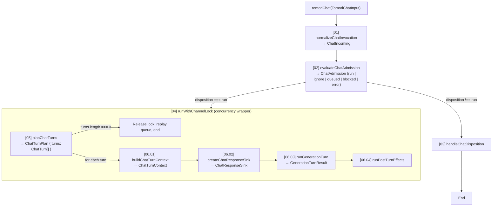

The chat pipeline turns a single Discord `messageCreate` event into zero, one, or many persona replies.
It is the primary coordinator of TomoriBot: context construction, tool execution, provider streaming,
and memory persistence are all reached through this pipeline.

- **Entry point**: `tomoriChat()` in `src/events/messageCreate/tomoriChat.ts`
- **Triggered by**: Discord `messageCreate` events, empty-response retries, queue replays, stop-response
  generation, cross-channel boomerang follow-ups, and command invocations.

## Stage flow

## Stage index

| # | Stage | Guide | Ownership |
|---|---|---|---|
| 01 | `normalizeChatInvocation` | [01: Input Normalization](/architecture/pipelines/chat/01-normalize-invocation/) | Sets defaults for optional input parameters. |
| 02 | `evaluateChatAdmission` | [02: Admission Check](/architecture/pipelines/chat/02-evaluate-admission/) | Filters suppressed messages, checks permissions, and gates queue entry. |
| 03 | `handleChatDisposition` | [03: Chat Disposition](/architecture/pipelines/chat/03-handle-disposition/) | Emits terminal logging and notifies caller of rejected or non-run outcomes. |
| 04 | `runWithChannelLock` | [04: Channel Lock](/architecture/pipelines/chat/04-channel-lock/) | Enforces channel mutex, keeps typing active, and replays queued turns. |
| 05 | `planChatTurns` | [05: Turn Planning](/architecture/pipelines/chat/05-plan-turns/) | Evaluates triggers and quotas, selects personas, and queues multi-persona turns. |
| 06 | Per-turn loop | [06: Per-Turn Loop](/architecture/pipelines/chat/06-per-turn/) | Runs context build, response sink setup, generation, and post-turn effects. |

## Cross-references

- [Context-Build Pipeline](/architecture/pipelines/context-build/): prompt assembly and dialogue hydration.
- [Tool-Loop Pipeline](/architecture/pipelines/tool-loop/): iterative model calls and tool execution.
- [Provider Pipeline](/architecture/pipelines/provider/): provider streaming, chunk normalization, and Discord delivery.
- [Memory Pipeline](/architecture/pipelines/memory/): passive short-term memory capture and retrieval.

## Concurrency and re-entrancy

- **Per-channel serialization**: `runWithChannelLock` permits exactly one active turn sequence per channel at a time.
- **Queueing and interruption**: messages arriving while a channel is busy are either enqueued for FIFO replay
  after lock release, converted to a follow-up interrupt if eligible, converted to a natural stop request,
  or ignored.
- **Re-entrant invocations**:
  - Empty-response retries bypass the channel lock using `skipLock=true` to reuse the existing turn lock.
  - Natural stop responses execute through `handleStopResponse` via `setImmediate` after outer lock release.
  - Cross-channel boomerang turns execute through `suppressNextSelfReply` via `setImmediate` after lock release.

## Troubleshooting files

The `/troubleshoot chat` command produces a private JSON diagnostic file for a user's recent message in the
current channel. It inspects in-memory traces recorded by `diagnosticTimeline.ts` across the past hour.

The diagnostic file records UTC timestamps, relative millisecond offsets, admission results, planned persona
turns, context message counts, attempt model labels, tool iterations, and Discord send events. It excludes
raw message content, prompts, user IDs, and raw channel IDs. The in-memory trace store retains at most 5,000
traces for one hour.

The timeline also records `typing_started` after the initial typing request completes,
`context_built` after context assembly (history REST duration, reply fetch count, participant
preparation duration, and native build duration), and `provider_first_chunk` on the first stream
progress callback for each provider call. The progress callback runs when a chunk reaches the
stream consumer, before chunk processing, and also refreshes the existing stream watchdog.

## Turn latency metric

`log.metric("chat_turn_latency", fields)` emits once when each started persona turn ends, including
failed turns and bot or webhook triggers without a diagnostic owner. Admission refusals and plans
with no persona turns emit no sample. A queued replay or persona job is a separate invocation;
personas in one invocation share its start, admission duration, and planning duration. The async
scope isolates concurrent channels and stops accepting updates when its turn ends.

All durations use `performance.now()` except `gateway_ms`, which compares wall clocks. Every sample
has the same fields. An unstarted duration or an unreached milestone is `-1`; counts and summed
image time start at zero. A failed stage that started still records its elapsed time. Durations
overlap and must not be added to reconstruct total latency.

| Number | Meaning |
|---|---|
| `gateway_ms` | Invocation entry wall time minus Discord's trigger `createdTimestamp`; includes upstream delay and clock skew and can be negative. |
| `admission_ms` | Time in `evaluateChatAdmission`. |
| `plan_ms` | Time in `planChatTurns`. |
| `context_ms` | This persona's full context build, including intent preflight. |
| `dispatch_ms` | Invocation entry to the first `streamToDiscord` adapter entry in this turn. Later personas include time spent on earlier personas. |
| `provider_ttfb_ms` | First adapter entry to its first stream progress callback; `-1` if that call produces no progress, even if a fallback later succeeds. |
| `first_message_ms` | Invocation entry to the first confirmed send recorded by `recordChatMessageSent`, including held response delivery. |
| `history_fetch_ms` | Sum of channel history `messages.fetch` durations. |
| `assets_ms` | Persona emoji, sticker, and custom expression loading. |
| `history_build_ms` | The whole `buildSimplifiedHistory` call, including `history_fetch_ms` and reply fetches. |
| `participant_ms` | The `prepareParticipantContext` call; hydration inside `buildContext` belongs to `native_ms`. |
| `participant_candidate_ms` | Candidate-source reads during fresh participant discovery, including repository work and retries. |
| `participant_members_ms` | Wall time for the concurrent member-resolution batch, including cache hits and failed lookups. |
| `participant_proxy_ms` | Proxy-identity source reads during fresh participant discovery. |
| `participant_composition_ms` | Discovery-plan composition for the current persona, including request-cache reuse. |
| `participant_candidate_reads` | Candidate-source read attempts. |
| `participant_member_cache_hits` | Member lookups present in the discovery's initial member-cache snapshot. |
| `participant_member_fetches` | Member lookups absent from that snapshot; a concurrent cache fill can still avoid REST. |
| `participant_proxy_reads` | Proxy-identity source read attempts. |
| `naming_ms` | The history naming projection. |
| `reunion_ms` | Reunion note resolution; `-1` when a borrowed trigger skips it. |
| `native_ms` | Sum of `buildContext` durations, including native assembly, participant hydration, RAG, and any preset reassembly. |
| `reaction_fetches` | Calls to `reaction.users.fetch` during metadata reveal; ordinary turns use cached reaction counts and record zero. |
| `reply_fetches` | Reply target REST calls in `withReplyContext`, after history-window and message-cache misses, including failed calls. |
| `image_fetches` | Network download attempts at the `safeDownload` seam in `fetchAndOptimizeImage`, including failed downloads but excluding data URIs and policy-blocked results. |
| `image_ms` | Sum of those download durations, through body download and excluding image optimization; overlapping downloads each contribute their wall time. |

The dispatch boundary precedes adapter-side image preparation and the provider HTTP request. Image
download time therefore falls after `dispatch_ms` and inside `provider_ttfb_ms` when the first call
downloads images. The download counter lives immediately around `safeDownload` in `imageProcessor.ts`,
so a cache returning before that seam skips both the counter and download timing. It counts download
operations, rather than individual redirect requests. No URLs, message text, model names, or endpoint
identifiers enter this metric.

| Dimension | Fixed values and meaning |
|---|---|
| `provider` | `anthropic`, `custom`, `deepseek`, `google`, `novelai`, `nvidia`, `openrouter`, `vertex`, `vertexexpress`, `zai`, `zaicoding`, or `unknown`; the first dispatched provider, otherwise the context's planned provider when known. Custom endpoint IDs collapse to `custom`. |
| `humanizer` | `none`, `light`, `medium`, or `heavy` when the toggles match that `/setup` preset, `custom` for any other combination, or `unknown` before context configuration is available. |
| `source` | `message`, `queue`, `persona_job`, `retry`, `manual`, or `stop`, using the diagnostic timeline's source precedence. |
| `rag` | `yes` when built context contains server document retrieval content, otherwise `no`; it does not claim every retrieval attempt injected content. |
| `history` | `reused` for a busy-stretch window, otherwise `rest`. |
| `participant_discovery` | `fresh` when this turn starts discovery, `reused` when it awaits a request-cached discovery, or `unmeasured` before preparation reaches the cache lookup. |
| `drafting` | `yes` when response review enabled holding response text during this turn, otherwise `no`. |

For example, compare `dispatch_ms` for the same provider and source before inspecting the stage and
download fields for the source of a change. `context_ms` minus the context stage fields
(`assets_ms`, `history_build_ms`, `participant_ms`, `naming_ms`, `reunion_ms`, `native_ms`) leaves
intent preflight, forced mentions, channel prompt lookups, sprite checks, and prefill.

The four participant substages and their lookup counters record only while `participant_ms` is
active, so later image-generation preparation cannot change them. Subtract these substages only
from that parent when attributing participant work. Member timing covers the whole concurrent batch,
so it does not sum overlapping lookup durations. Reused discovery leaves candidate, member, and proxy
timings at `-1` and their counts at zero. Its wait for an in-flight discovery remains inside
`participant_ms`, and composition is measured again for the current persona. Failed stages record
elapsed time; unreached stages remain `-1`. Exclude those sentinels when calculating a remainder.

## Source pointers

- `src/events/messageCreate/tomoriChat.ts`: main chat entry point and stage coordinator.
- `src/utils/chat/channelQueue.ts`: channel locking, queue storage, and re-entry helpers.
- `src/utils/chat/diagnosticTimeline.ts`: per-turn event recording and diagnostic trace store.
- `src/utils/chat/turnLatency.ts`: independent per-turn latency accumulator and fixed metric shape.
- `src/commands/troubleshoot/chat.ts`: troubleshooting diagnostic command implementation.
